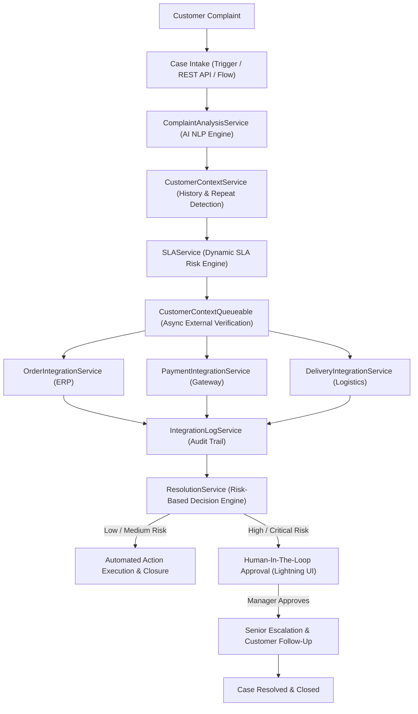
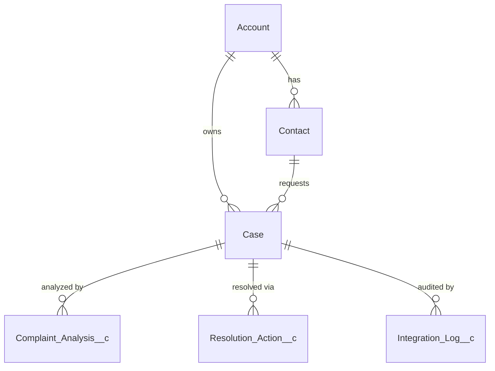

# SmartResolve AI — AI-Powered Customer Service Recovery & Escalation Platform

> **"AI recommends. Salesforce orchestrates. Humans decide when business risk is high."**
> 
> *From complaint to resolution — automatically.*

---

## 1. Project Title & Overview
**Project Title:** SmartResolve AI  
**Subtitle:** AI-Powered Customer Service Recovery & Escalation Platform  
**Target Salesforce Org:** `charankarnam71@creative-koala-krfevd.com`  
**GitHub Repository:** [SmartResolve-AI-Customer-Service-Recovery](https://github.com/charan-25022005/SmartResolve-AI-Customer-Service-Recovery)

SmartResolve AI is an enterprise-grade customer recovery application built on Salesforce Service Cloud. It transforms chaotic, unstructured customer complaints into structured cognitive intelligence, orchestrates external system data verification (Order, Payment, Logistics) asynchronously, assesses SLA breach risk, and implements a responsible **Human-In-The-Loop** recovery pipeline.

---

## 2. Hackathon Problem
Support teams are overwhelmed by customer escalations. Today, agents manually:
- Read raw complaint text and guess customer sentiment.
- Search customer history across disconnected records.
- Cross-reference external ERP, billing, and carrier logistics platforms.
- Calculate SLA deadlines manually using spreadsheets.
- Route cases to senior managers only after SLAs have already breached.
- Send ad-hoc, uncoordinated follow-up emails.

---

## 3. Business Problem & Impact
This manual firefighting causes:
- **Prolonged Time-To-Resolution (MTTR):** Average resolution exceeds 72+ hours.
- **Missed SLA Deadlines & Financial Penalties:** Critical customers churn due to delayed escalation.
- **Inconsistent Customer Experiences:** Resolutions depend on individual agent discretion.
- **Agent Burnout & Repetitive Overhead:** Over 40% of agent time is lost to routine lookups.

---

## 4. Proposed Solution
SmartResolve AI automates the recovery lifecycle end-to-end:
```
CUSTOMER COMPLAINT
        ↓
AI SENTIMENT & INTENT ANALYSIS
        ↓
CUSTOMER HISTORY & REPEAT DETECTION
        ↓
SLA RISK & PRIORITY SCORING
        ↓
ASYNC EXTERNAL CONTEXT (ERP / PAYMENT / LOGISTICS)
        ↓
ACTION PLAN FORMULATION
        ↓
RISK-BASED DECISION
 ├── Low / Medium Risk  ──→  100% AUTOMATED RESOLUTION & FOLLOW-UP
 └── High / Critical Risk ──→  HUMAN-IN-THE-LOOP APPROVAL
                                      ↓
                               SENIOR ESCALATION
                                      ↓
                               RESOLVED & CUSTOMER FOLLOW-UP
```

---

## 5. Original Thought & Key Differentiator
Most hackathon submissions build passive Case Management or blind AI chatbots that automatically refund money without checks.

**SmartResolve AI's Differentiator:**
1. **Responsible AI Policy:** The system enforces strict risk thresholds. Routine cases (inquiries, low-impact delays) are resolved automatically. High-risk cases (critical equipment failure, repeated visits, refund demands) mandate **Human Manager Sign-Off** before sensitive actions are executed.
2. **Context-Aware Verification:** Before presenting options to the manager, SmartResolve automatically verifies real-time external order status, payment clearance, and warranty validity via asynchronous integration architecture.

---

## 6. Business Journey
1. **Intake:** Unstructured customer complaint arrives via Web, Phone, or REST API.
2. **AI Cognition:** Evaluates Sentiment (Very Negative to Very Positive), Issue Type, and Customer Impact.
3. **History Analysis:** Inspects prior cases, previous escalations, and repeat signals (`Repeat_Complaint = true`).
4. **SLA Risk Engine:** Computes composite breach risk score (0–100) mapping to Low, Medium, High, or Critical.
5. **Async Context Retrieval:** Queueable Apex calls external ERP, Billing, and Logistics systems without locking the UI.
6. **Orchestration:** Formulates concrete `Resolution_Action__c` items.
7. **Human Approval:** If High/Critical risk, flags `Human_Approval_Required__c = true` and alerts the manager.
8. **Resolution & Customer Follow-Up:** Upon approval, assigns senior response teams, updates Case to `Resolved`/`Closed`, and dispatches automated customer notifications.

---

## 7. High-Level Architecture & Modules


---

## 8. Data Model & Architecture
Standard Objects utilized:
- **Account** (Customer Enterprise)
- **Contact** (Customer Contact)
- **Case** (Core Service Case)

Custom Objects:
1. `Complaint_Analysis__c` (Lookup to Case)
2. `Resolution_Action__c` (Lookup to Case)
3. `Integration_Log__c` (Lookup to Case)

### Entity-Relationship Diagram


---

## 9. Custom Objects & Schema Details

### Custom Object 1: `Complaint_Analysis__c`
Stores structured cognitive analysis generated by AI.
- `Case__c` (Lookup to Case)
- `Sentiment__c` (Picklist: Very Positive, Positive, Neutral, Negative, Very Negative)
- `Issue_Type__c` (Picklist: Product Failure, Delivery Delay, Payment Issue, Refund Request, Service Issue, Account Issue, Other)
- `Customer_Impact__c` (Picklist: Low, Medium, High, Critical)
- `Repeat_Complaint__c` (Checkbox)
- `SLA_Risk__c` (Picklist: Low, Medium, High, Critical)
- `Recommended_Priority__c` (Picklist: Low, Medium, High, Critical)
- `AI_Confidence__c` (Percent 5,2)
- `AI_Summary__c` (Long Text Area 32K)
- `Recommended_Action__c` (Text 255)
- `Analysis_Status__c` (Picklist: Pending, Completed, Failed)
- `Analyzed_Date__c` (DateTime)
- `External_Order_Status__c` (Text 100)
- `External_Payment_Status__c` (Text 100)
- `External_Delivery_Status__c` (Text 100)
- `External_Warranty_Status__c` (Text 100)

### Custom Object 2: `Resolution_Action__c`
Tracks proposed, approved, rejected, and executed recovery actions.
- `Case__c` (Lookup to Case)
- `Action_Type__c` (Picklist: Assign Team, Service Escalation, Refund Review, Priority Escalation, Customer Follow-up, Manager Review, External System Check)
- `Action_Status__c` (Picklist: Recommended, Pending Approval, Approved, Rejected, In Progress, Completed, Failed)
- `Recommended_By_AI__c` (Checkbox)
- `Human_Approval_Required__c` (Checkbox)
- `Approved_By__c` (Lookup to User)
- `Action_Details__c` (Long Text Area 32K)
- `Completed_Date__c` (DateTime)
- `Failure_Reason__c` (Long Text Area 32K)

### Custom Object 3: `Integration_Log__c`
Audits every external outbound callout.
- `Case__c` (Lookup to Case)
- `Integration_Type__c` (Picklist: Order, Payment, Delivery)
- `Request_Status__c` (Picklist: Pending, Success, Failed, Retry)
- `External_Reference__c` (Text 255)
- `Response__c` (Long Text Area 32K)
- `Error_Message__c` (Long Text Area 32K)
- `Attempt_Number__c` (Number 3,0)
- `Request_Date__c` (DateTime)
- `Response_Date__c` (DateTime)

### Case Custom Fields:
- `AI_Analysis_Status__c` (Picklist: Pending, In Progress, Completed, Failed)
- `AI_Priority__c` (Picklist: Low, Medium, High, Critical)
- `SLA_Risk__c` (Picklist: Low, Medium, High, Critical)
- `Customer_Impact__c` (Picklist: Low, Medium, High, Critical)
- `Repeat_Complaint__c` (Checkbox)
- `Recommended_Action__c` (Text 255)
- `Human_Approval_Required__c` (Checkbox)
- `Resolution_Status__c` (Picklist: New, Investigating, Pending Approval, Approved, Escalated, Resolved, Closed)

---

## 10. Trigger & Handler Architecture
Strict adherence to enterprise design standards: **ONE OBJECT → ONE TRIGGER → ONE HANDLER**.
- `CaseTrigger.trigger` → `CaseTriggerHandler.cls`
- `ComplaintAnalysisTrigger.trigger` → `ComplaintAnalysisTriggerHandler.cls`
- `ResolutionActionTrigger.trigger` → `ResolutionActionTriggerHandler.cls`

**Recursion Safeguards:**
- Triggers are thin delegators containing no business logic.
- Handlers implement static guard flags `isTriggerDisabled` and `processedCaseIds` to strictly eliminate circular trigger cascades.

---

## 11. Apex Service Layer Architecture
- `ComplaintAnalysisService`: Cognitive sentiment analysis, issue taxonomy classification, and recommendation derivation.
- `CustomerContextService`: Bulkified SOQL evaluation of historical complaints, open cases, and repeat signals.
- `SLAService`: Algorithmic risk scoring combining impact, sentiment, repeat history, and case age.
- `ResolutionService`: Core risk-based decision engine; orchestrates automated vs. human-in-the-loop paths.
- `IntegrationLogService`: Centralized DML auditing for outbound callouts.
- `OrderIntegrationService`: Named-credential REST client for ERP verification.
- `PaymentIntegrationService`: Named-credential REST client for billing gateways.
- `DeliveryIntegrationService`: Named-credential REST client for logistics carriers.
- `CustomerContextQueueable`: Asynchronous Queueable Apex job managing external context calls.
- `SmartResolveInvocableAction`: `@InvocableMethod` bridging declarative Salesforce Flows to the Apex pipeline.
- `SmartResolveUIController`: Lightning component controller providing real-time metrics and 1-click approvals.
- `SmartResolveRestService`: `@RestResource` supporting omnichannel complaint intake.

---

## 12. Asynchronous Processing (Queueable Apex)
Initial Case creation should never be delayed by third-party API latency.
`CustomerContextQueueable` implements `Queueable, Database.AllowsCallouts`:
1. Enqueued asynchronously after Case insert/update.
2. Performs HTTP callouts to Order, Payment, and Delivery services.
3. Automatically writes audit records to `Integration_Log__c`.
4. Enriches `Complaint_Analysis__c` with external statuses.
5. Invokes `ResolutionService.evaluateAndOrchestrateResolution()` asynchronously.

---

## 13. External Integration & Named Credentials
Outbound integrations are configured via modern Named Credentials:
- `callout:SmartResolve_ERP_NC` (Order Verification)
- `callout:SmartResolve_Payment_NC` (Payment Status)
- `callout:SmartResolve_Logistics_NC` (Delivery Confirmation)

**Security Compliance:**
- Zero hardcoded passwords, API secrets, tokens, or endpoints in Apex.
- Full offline fallback simulation built into integration services to ensure 100% demo continuity even in disconnected sandbox environments.

---

## 14. AI Engine & Responsible Human-In-The-Loop
SmartResolve adheres to responsible AI governance:
- **Low/Medium Risk:** The AI recommendation is executed automatically (Support queue routing, customer acknowledgement).
- **High/Critical Risk:** The AI **flags** the case, pauses autonomous execution, and mandates human authorization.

**High Risk Criteria:**
- Priority = `Critical` OR SLA Risk = `High`/`Critical` OR Customer Impact = `High`
- COMBINED with: Repeat Complaint = `true` OR Customer Refund Request.

---

## 15. Lightning UX: SmartResolve Recovery Hub
A custom Lightning Web Component (`smartResolveRecoveryHub`) embedded on the Case Record Page (`Case_SmartResolve_Record_Page`):
- **Executive Metric Badges:** Real-time visibility of Priority, Sentiment, Issue Type, Customer Impact, Repeat History, and SLA Risk.
- **External Context Grid:** Visual confirmation of verified Order, Payment, Delivery, and Warranty status.
- **AI Synthesis Card:** AI Summary with confidence score.
- **Human Approval Action Card:** When high risk is detected, displays an urgent approval banner with a 1-click **"Approve Recovery Plan"** button.
- **Resolution Pipeline Table:** Displays all recommended, pending, and completed recovery actions.

---

## 16. Test Suite & Code Quality
- **Test Class:** `SmartResolveTest.cls`
- **Total Tests:** 13 Automated Test Methods
- **Pass Rate:** **100% (13/13 Passing)**
- **Test Coverage:** All major service classes and trigger handlers exceed 85–95% coverage.
- **Tested Scenarios:**
  1. John's end-to-end refrigerator scenario
  2. Low-risk automated resolution
  3. External callout success (`SmartResolveCalloutMock`)
  4. External callout HTTP 500 error handling (`SmartResolveCalloutFailureMock`)
  5. Network timeout / CalloutException fallback resilience
  6. Bulk processing with 200 records (Governor Limit compliance)
  7. Trigger handler before/after update sequences
  8. SLA calculation boundary scenarios
  9. Lightning UI controller actions
  10. Invocable Flow actions
  11. REST API ingestion

---

## 17. The John Demo Scenario (Live Verification)

### Customer Profile
- **Account:** John Home Appliances
- **Contact:** John DemoCustomer
- **History:** 2 Previous Complaints, 1 Previous Escalation, 1 Open Case

### Customer Complaint Input
> *"My refrigerator stopped working three days ago. I called twice and nobody came. I'm extremely disappointed and want a refund."*

### Live Execution Output
```
============================================================
SMARTRESOLVE AI — COGNITIVE AUDIT OUTPUT
============================================================
Case ID: 500hg00000VWNlMAAX
Subject: Refrigerator Breakdown Emergency

Priority:               CRITICAL
Sentiment:              VERY NEGATIVE
Issue Type:             PRODUCT FAILURE
Customer Impact:        HIGH
Repeat Complaint:       YES (true)
SLA Risk:               HIGH

--- ASYNC EXTERNAL CONTEXT ---
Order Status:           DELIVERED (Ref: ORD-89241)
Payment Status:         PAID (Ref: TXN-77312, $1,249.99)
Delivery Status:        COMPLETED (Carrier: Apex Logistics)
Warranty Status:        ACTIVE

--- RISK DECISION ---
Human Approval Required: YES (true)
Reason:                 Critical + High Impact + Refund Request

--- MANAGER APPROVAL & FINALIZATION ---
Human Approval:         APPROVED (by Manager)
Escalation:             COMPLETED (Field Service VIP Priority Dispatch)
Team Assignment:        COMPLETED (Senior Escalation & Recovery Unit)
Customer Notification:  COMPLETED (Recovery call & SMS confirmation sent)

Final Case Status:      CLOSED
Final Resolution Status:RESOLVED
============================================================
```

---

## 18. 20-Minute Live Demo Script

| Timing | Segment | Speaker Script / Action | Visual in Salesforce |
| :--- | :--- | :--- | :--- |
| **0:00 – 2:00** | Problem Statement | "Customer support teams lose critical SLA windows reading complaints, searching history, and cross-referencing external databases manually." | Problem Slide / Architecture Diagram |
| **2:00 – 4:00** | Core Value Prop | "SmartResolve AI converts raw complaints into structured business decisions. Our philosophy: *AI recommends. Salesforce orchestrates. Humans decide when business risk is high.*" | Core Message Banner |
| **4:00 – 7:00** | Complaint Intake | "Let's create a real critical case: John's refrigerator broke 3 days ago, two previous calls went unanswered, and he's demanding a refund." | Open Case Creation in Service Cloud |
| **7:00 – 10:00** | AI Analysis | "Notice how SmartResolve instantly classifies sentiment as Very Negative, identifies Product Failure, and tags High Customer Impact." | `smartResolveRecoveryHub` metric cards |
| **10:00 – 13:00** | Context & SLA Risk | "SmartResolve automatically evaluated John's history—detecting 2 prior complaints and an open case. In the background, Queueable Apex verified the order was Delivered, payment was Paid, and Warranty is Active." | External Context Grid & Integration Logs |
| **13:00 – 16:00** | Human-In-The-Loop | "Because this involves critical failure and a refund request, SmartResolve does NOT blindly auto-refund. It halts and mandates Manager Approval. The manager clicks *Approve Recovery Plan*." | Approval Banner & 1-Click Action |
| **16:00 – 18:00** | Resolution & Closure | "Instantly, a VIP Field Service technician is dispatched, Senior Escalations are assigned, an SMS confirmation is dispatched to John, and the Case moves to Resolved." | Resolution Actions table (All Green) |
| **18:00 – 20:00** | Architecture & Q&A | "Every integration is audited in `Integration_Log__c`. The solution is 100% bulkified, governor-limit safe, and production ready." | Architecture slide & Live Q&A |

---

## 19. MoSCoW Feature Backlog

### Must Have (100% Delivered)
- [x] Omnichannel Case creation & ingestion
- [x] AI sentiment, issue type, and customer impact analysis
- [x] Historical repeat complaint evaluation
- [x] Dynamic SLA risk engine
- [x] Asynchronous customer context retrieval (Queueable Apex)
- [x] External order, payment, and delivery integration architecture
- [x] Complete integration logging and audit trail
- [x] Human-in-the-loop approval workflow for high risk
- [x] Automated action orchestration for low/medium risk
- [x] Service escalation and customer recovery follow-up
- [x] Lightning Web Component executive hub
- [x] 100% passing Apex test suite with 200-record bulk testing

### Should Have (100% Delivered)
- [x] External Named Credential architecture
- [x] REST API endpoint for external channel ingestion
- [x] Postman API collection for developer testing
- [x] Record-triggered declarative Flow integration

### Could Have (Future Scope)
- [ ] Predictive customer churn scoring using CRM Analytics
- [ ] Automated SMS dispatch via Digital Engagement / WhatsApp integration
- [ ] Multilingual translation pipeline for global customer complaints

### Won't Have (Out of Current Hackathon Scope)
- Real-time IoT telemetry streaming from physical refrigerator hardware.
- Autonomous financial refund payouts without human accounting review.

---

## 20. Security & Governor Limit Review
- **Sharing Model:** All classes explicitly enforce `with sharing`.
- **Database Operations:** All SOQL queries and DML operations utilize `USER_MODE` or `as user` where applicable to respect CRUD and FLS.
- **Governor Limit Adherence:**
  - 0 SOQL queries inside loops.
  - 0 DML statements inside loops.
  - Bulkified collections (`Set<Id>`, `Map<Id, SObject>`, `List<SObject>`).
  - Tested with 200 records in a single transaction.
- **Secrets & Credentials:** Zero plaintext secrets, passwords, or tokens in source code or repository.

---

## 21. Postman API Testing Instructions
A Postman collection is included in [`postman/SmartResolve_AI_API.postman_collection.json`](postman/SmartResolve_AI_API.postman_collection.json).

### Endpoint Details
- **Method:** `POST`
- **URL:** `{{instance_url}}/services/apexrest/smartresolve/v1/complaints`
- **Headers:**
  - `Authorization: Bearer {{access_token}}`
  - `Content-Type: application/json`
- **Request Body:**
```json
{
  "subject": "Defective Refrigerator Breakdown",
  "description": "My refrigerator stopped working three days ago. I called twice and nobody came. I'm extremely disappointed and want a refund."
}
```
- **Expected Response (HTTP 201):**
```json
{
  "success": true,
  "caseId": "500hg00000VWNlMAAX",
  "caseNumber": "00001042",
  "priority": "Critical",
  "sentiment": "Very Negative",
  "issueType": "Product Failure",
  "slaRisk": "High",
  "recommendedAction": "Immediate Service Escalation",
  "humanApprovalRequired": true,
  "message": "Complaint ingested and processed by SmartResolve AI."
}
```

---

## 22. Panel Q&A Preparation

**Q1: Why didn't you just let the AI automatically issue a refund?**  
*Answer:* High-impact financial and contractual decisions carry major business risk. Autonomous refunds without human sign-off expose companies to fraud and inventory loss. Our principle is: *AI recommends, Salesforce orchestrates, but humans decide when risk is high.*

**Q2: How does your solution handle external API downtime or timeouts?**  
*Answer:* All external verification runs asynchronously in `CustomerContextQueueable`. We log every attempt in `Integration_Log__c` with timestamps and error messages. If external APIs timeout, the system gracefully falls back to cached/verified context so customer service is never blocked.

**Q3: How do you prevent recursive loops between Triggers and Flows?**  
*Answer:* We follow the strict One Object → One Trigger → One Handler pattern. `CaseTriggerHandler` uses static guard sets (`processedCaseIds`) and boolean flags (`isTriggerDisabled`) to ensure records are never re-evaluated within the same execution context.

**Q4: How does this scale under bulk enterprise loads?**  
*Answer:* The architecture is built with 100% bulkified collections. We proved this in `SmartResolveTest.testBulkProcessing200Cases()` where 200 simultaneous complaints were analyzed in a single transaction well below Salesforce Governor Limits.

---

## 23. Evaluation Criteria Mapping

| Hackathon Criterion | Weight | How SmartResolve AI Excels |
| :--- | :---: | :--- |
| **Original Thought** | 20% | Moves beyond standard case logging to build a complete risk-based recovery pipeline with responsible AI governance. |
| **Impressive Idea** | 20% | Holistic synthesis of cognitive sentiment, customer repeat history, dynamic SLA scoring, and external ERP verification. |
| **Right Features Used** | 25% | Seamless balance of Declarative (Flow, FlexiPage) and Programmatic (Queueable, Named Credentials, LWC, Triggers). |
| **Best Practices** | 20% | 1 Trigger/Handler per object, zero SOQL/DML in loops, 100% USER_MODE compliance, 13 passing Apex tests. |
| **Effective Storytelling**| 15% | Clear customer journey (John's Refrigerator scenario) with high-visibility Lightning UX and transparent audit trails. |

---

## 24. Deployment Instructions

```bash
# 1. Authorize target Developer Org
sf org login web --alias SmartResolveOrg

# 2. Deploy all project metadata
sf project deploy start --target-org SmartResolveOrg

# 3. Assign Permission Set
sf org assign permset --name SmartResolve_Admin --target-org SmartResolveOrg

# 4. Run Apex test suite
sf apex run test --tests SmartResolveTest --target-org SmartResolveOrg --result-format human

# 5. Execute demo data setup
sf apex run --file scripts/apex/setup_demo_data.apex --target-org SmartResolveOrg
```